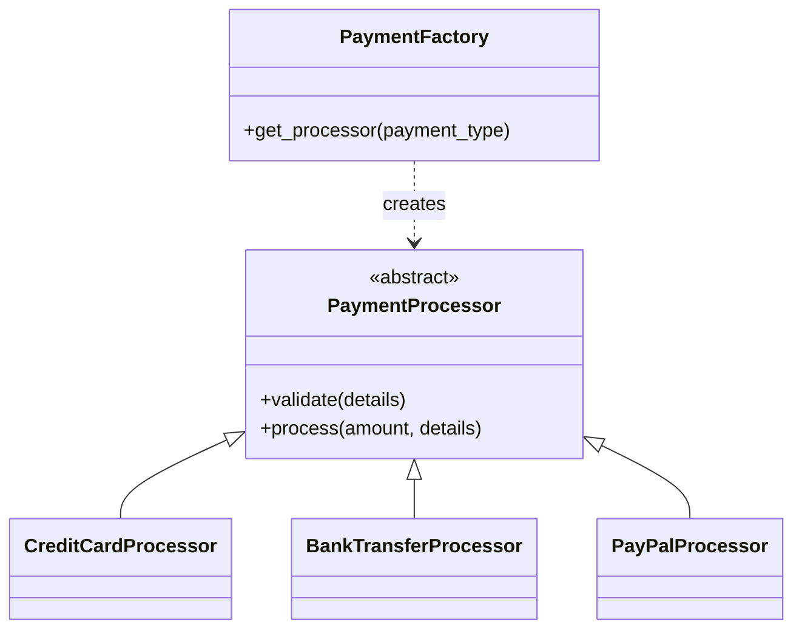
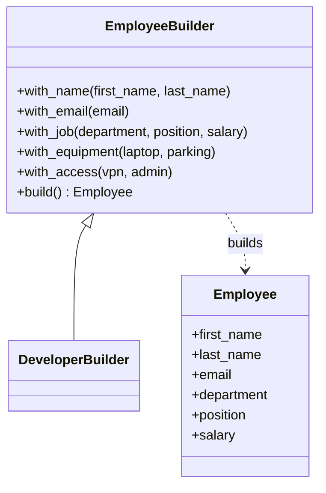
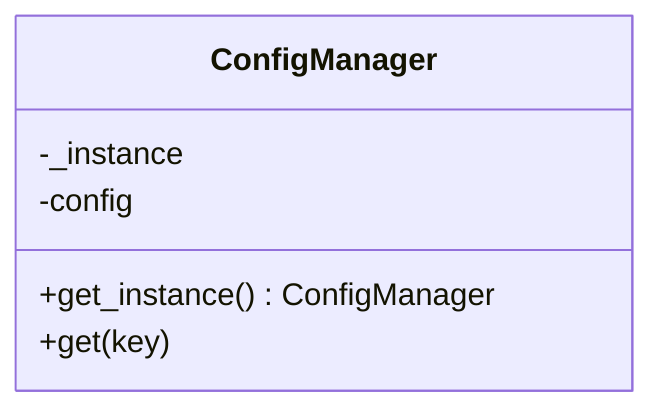
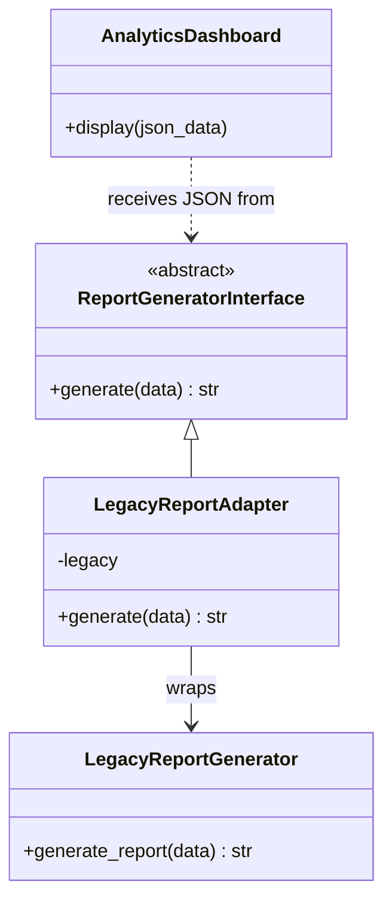
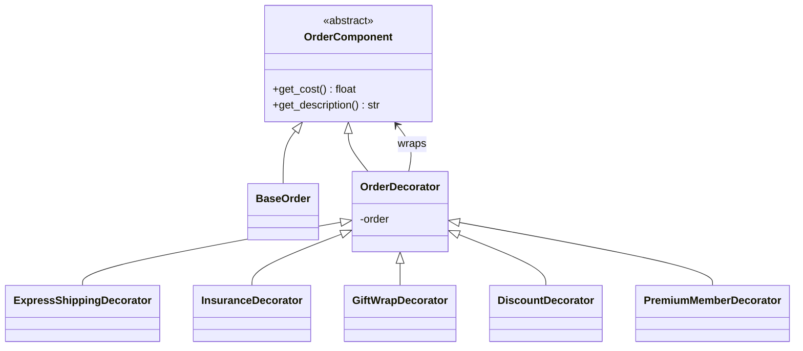
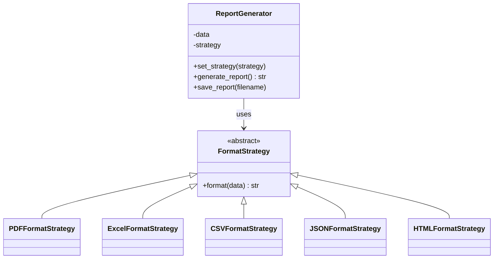
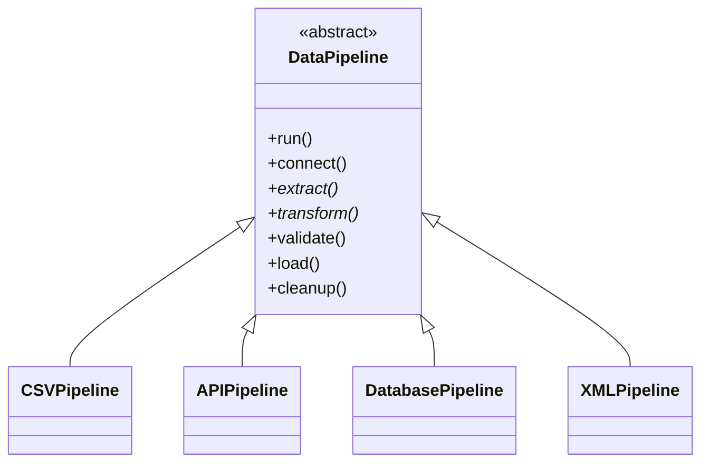

# UML Class Diagrams

These UML diagrams describe the main classes before the Python implementation.

## Factory Pattern

## Builder Pattern

## Singleton Pattern

## Adapter Pattern

## Decorator Pattern

## Strategy Pattern

## Template Method Pattern

